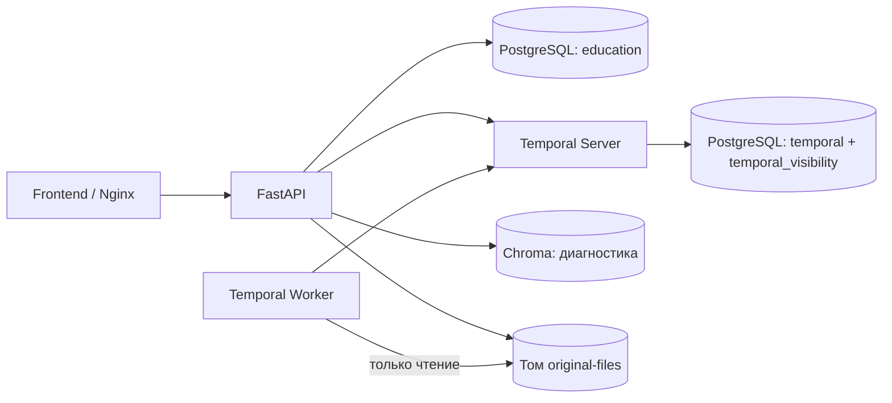

# Архитектура после второго этапа

P и S — базы одного PostgreSQL-сервиса. Шесть постоянных сервисов:
frontend, api, worker, temporal, postgres, chroma. Четыре одноразовые службы:
temporal-db-init, temporal-schema-init, temporal-namespace-init, app-migrate.

Alembic изменяет только education. Базы Temporal обслуживаются официальными инструментами
независимо от миграций приложения. Повторная подготовка не сбрасывает данные.
API сохраняет версии короткими транзакциями — Workflow для этого не требуется.

Worker пока выполняет диагностическую последовательность Activity → таймер → Activity.
Парсер, ML и индексирование программ в Chroma ещё не добавлены.
Namespace education, очередь education-default. Temporal хранит техническую историю,
а program_versions — постоянную историю программы. Незавершённая Activity может
повториться; будущая бизнес-логика должна быть идемпотентной.

Readiness выполняет PostgreSQL-запрос, DescribeNamespace RPC и Chroma-запрос
с ограниченным ожиданием. Liveness проверяет процесс. Worker healthcheck проверяет
poller, smoke — реальное исполнение и воспроизведение истории.

Оригиналы хранятся в отдельном томе под серверными UUID, имя пользователя — метаданные.
API имеет запись, Worker — чтение. При неизвестном результате commit файл сохраняется
для безопасной сверки; audit_originals ничего не удаляет автоматически.

Приёмочные остановки и пересоздания выполняются в отдельном Compose-проекте с портами
18000/18080 и собственными томами. Основной запуск не затрагивается.
